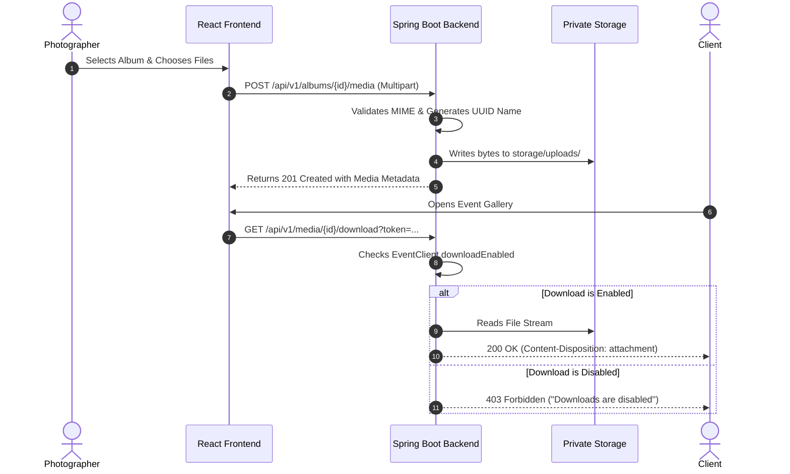

# LensVault — Secure Digital Event Media Delivery Platform

[](https://www.oracle.com/java/)
[](https://spring.io/projects/spring-boot)
[](https://react.dev/)
[](https://www.mysql.com/)
[]()

> **"Your memories. Beautifully delivered."**  
> *Headline:* **Every Event. Every Memory. One Secure Gallery.**

---

## 1. Project Introduction

**LensVault** is a secure, role-based, full-stack digital media delivery platform engineered for professional photographers, studios, and their clients. Rather than relying on generic cloud storage links or unsecured file sharing tools, LensVault gives photographers a branded, private platform to manage shoot schedules, organize high-resolution photographs and 4K video clips into albums, assign access permissions to specific clients, and enforce granular download permissions.

---

## 2. Problem Statement

Professional event photographers face substantial challenges when delivering media deliverables to clients:
1. **Unsecured Delivery Links:** Services like Google Drive, Dropbox, and WeTransfer rely on shared URLs that can easily be forwarded to unauthorized parties.
2. **Loss of Download & Payment Control:** Photographers often want clients to preview watermarked or proofing galleries before final invoices are paid, but traditional tools lack instant server-side download locks.
3. **Disorganized Client Experience:** Clients are overwhelmed by unorganized folders instead of structured, cinematic galleries divided by event milestones (e.g., *Ceremony*, *Portraits*, *Reception*).
4. **Data Privacy & Leakage Concerns:** High-profile wedding and VIP corporate media requires strict role-based access control (RBAC), private local storage, and immutable audit logging.

---

## 3. Project Objectives

- Provide a **cinematic, minimal, dark-mode photography portal** styled with charcoal blacks, warm whites, and muted gold accents.
- Implement **Spring Security 6 with HMAC-SHA256 JWT tokens** ensuring complete server-side role and resource ownership validation.
- Store media in a **private local directory** outside the publicly accessible web root, serving media only through authenticated backend streaming endpoints.
- Allow photographers to **grant or revoke client access** and **toggle full-resolution downloads** on a per-client, per-event basis.
- Provide separate, tailored dashboard experiences for **Photographers**, **Clients**, and **Administrators**.

---

## 4. Features & Modules

### A. Photographer Module
- Account registration, authentication, and secure session management.
- Complete CRUD operations for Events (Event name, type, date, venue, description, cover photo).
- Album management within events (e.g., *Vows*, *Ceremony*, *Reception*).
- Multipart bulk media upload for JPEG, PNG, WebP photos and MP4, WebM videos with real-time progress indicators.
- Client assignment by email with individual access and download toggles.
- Copyable, secure client invitation tokens.
- Studio dashboard with live database metrics and Recharts deliverables breakdown.

### B. Client Module
- Secure authentication showing **only events explicitly assigned to their account**.
- Responsive photography grid with 3:2 aspect ratios and media type badges.
- Full-screen **cinematic Lightbox** with keyboard navigation (Left/Right arrow keys).
- Native HTML5 **video playback** for cinematic teasers and highlight reels.
- Permission-aware **original resolution downloads** (locked if photographer restricts downloads).

### C. Administrator Module
- Comprehensive platform telemetry (total users, events, albums, media files, disk storage utilized).
- User moderation (search, role filtering, account activation/deactivation).
- Platform audit trails capturing timestamps, actors, and events (`USER_LOGIN`, `CREATE_EVENT`, `UPLOAD_MEDIA`, `UPDATE_CLIENT_PERMISSIONS`).

---

## 5. Technology Stack

### Frontend
- **Framework:** React.js (Vite)
- **Language:** JavaScript (ES6+)
- **Routing:** React Router DOM
- **HTTP Client:** Axios with JWT interceptors
- **Icons:** Lucide React
- **Data Visualization:** Recharts
- **Styling:** Vanilla CSS3 design system with custom design tokens

### Backend
- **Platform:** Java 21 LTS
- **Framework:** Spring Boot 3.3.4
- **Build Tool:** Apache Maven
- **Security:** Spring Security 6, BCrypt Password Encoder, JJWT (io.jsonwebtoken 0.12.5)
- **Persistence:** Spring Data JPA (Hibernate 6)
- **Validation:** Jakarta Bean Validation (Hibernate Validator)
- **Database:** MySQL 8.0 (with in-memory H2 for isolated automated testing)
- **Testing:** JUnit 5, Spring Boot Test, Spring Security Test

---

## 6. Architecture Explanation

LensVault utilizes an n-tier architecture with clear separation of concerns:
- **Presentation Layer (React):** Single-page application communicating via REST APIs.
- **Security Filter (Spring Security):** `JwtAuthenticationFilter` validates Bearer headers and query parameters for browser media streaming.
- **Controller Layer:** Validates incoming DTOs and handles HTTP mappings.
- **Service Layer:** Enforces business logic and checks that photographers own events and clients have active assignments before reading media.
- **Storage Layer (`StorageService`):** Manages disk storage using UUIDs and prevents path traversal attacks.
- **Data Layer:** JPA repositories executing queries against MySQL 8.0.

See [ARCHITECTURE.md](file:///c:/Users/venky/Desktop/Digital%20Event%20Media%20Delivery%20Platform/ARCHITECTURE.md) for full architecture diagrams and workflows.

---

## 7. Project Directory Structure

```text
Digital Event Media Delivery Platform/
├── backend/
│   ├── src/
│   │   ├── main/
│   │   │   ├── java/com/lensvault/
│   │   │   │   ├── LensVaultApplication.java
│   │   │   │   ├── config/          # CORS, MVC, DataInitializer seeder
│   │   │   │   ├── controller/      # Auth, Event, Album, Media, Client, Admin
│   │   │   │   ├── dto/             # Request & Response transfer objects
│   │   │   │   ├── entity/          # User, Event, Album, Media, EventClient, AuditLog
│   │   │   │   ├── exception/       # GlobalExceptionHandler, Custom exceptions
│   │   │   │   ├── repository/      # Spring Data JPA interfaces
│   │   │   │   ├── security/        # JWT Provider, AuthFilter, UserPrincipal
│   │   │   │   ├── service/         # Business logic layer
│   │   │   │   └── storage/         # StorageService & LocalStorageService
│   │   │   └── resources/
│   │   │       └── application.yml  # Database and storage properties
│   │   └── test/                    # JUnit 5 integration & unit tests
│   └── pom.xml
├── frontend/
│   ├── src/
│   │   ├── api/                     # Axios client & API endpoints
│   │   ├── components/
│   │   │   ├── common/              # Button, Modal, Badge, Alert, EmptyState
│   │   │   ├── events/              # EventCard, CreateEventModal, ClientAssignmentModal
│   │   │   ├── gallery/             # MediaGrid, LightboxModal, UploadModal
│   │   │   └── layout/              # Navbar, Sidebar, AppLayout, Footer
│   │   ├── context/                 # AuthContext
│   │   ├── pages/
│   │   │   ├── public/              # Landing, Login, Register, 403, 404
│   │   │   ├── photographer/        # Dashboard, Events, EventDetail, AlbumDetail
│   │   │   ├── client/              # ClientDashboard, ClientEvent, ClientAlbum
│   │   │   └── admin/               # AdminDashboard, Users, AuditLogs
│   │   ├── routes/                  # ProtectedRoute, RoleRoute
│   │   ├── styles/                  # index.css design system
│   │   ├── App.jsx
│   │   └── main.jsx
│   ├── package.json
│   └── vite.config.js
├── storage/
│   ├── uploads/                     # Private stored media files (UUID named)
│   └── thumbnails/
├── start-all.bat                    # One-click Windows launcher
├── start-backend.bat                # Windows backend run script
├── start-frontend.bat               # Windows frontend run script
├── schema.sql                       # MySQL DDL schema script
├── ARCHITECTURE.md                  # System architecture document
├── TESTING_CHECKLIST.md             # Faculty demonstration manual test script
└── README.md
```

---

## 8. Database Design & Entity Relationships

The MySQL database is named **`lensvault_db`**.

1. **`users`**
   - `id`, `full_name`, `email` (UNIQUE), `password_hash`, `role` (PHOTOGRAPHER, CLIENT, ADMIN), `active`, `created_at`, `updated_at`.
2. **`events`**
   - `id`, `event_name`, `event_type`, `event_date`, `venue`, `description`, `status`, `cover_image_url`, `photographer_id` (FK -> users), `created_at`, `updated_at`.
3. **`event_clients`**
   - `id`, `event_id` (FK -> events), `client_id` (FK -> users), `access_enabled`, `download_enabled`, `invitation_token`, `created_at`.
   - Unique constraint on `(event_id, client_id)`.
4. **`albums`**
   - `id`, `album_name`, `description`, `event_id` (FK -> events), `created_at`, `updated_at`.
5. **`media`**
   - `id`, `original_filename`, `stored_filename` (UNIQUE), `storage_path`, `content_type`, `file_size`, `media_type` (IMAGE, VIDEO), `album_id` (FK -> albums), `uploader_id` (FK -> users), `created_at`.
6. **`audit_logs`**
   - `id`, `actor_email`, `action`, `resource_type`, `resource_id`, `details`, `timestamp`.

---

## 9. Software Prerequisites

- **Operating System:** Windows 10 or 11 (64-bit)
- **Java Development Kit:** JDK 21
- **Node.js:** v18+ or v24+
- **Apache Maven:** 3.8+ or 3.9+ (Installed on system at `C:\Users\venky\apache-maven-3.9.6\bin`)
- **Database:** MySQL 8.0 Server (Running as Windows Service `MySQL80`)

---

## 10. Exact Setup Commands for Windows

Open PowerShell or Command Prompt in the workspace directory:

```powershell
# 1. Verify MySQL Service is running
Get-Service -Name MySQL80

# 2. Create the MySQL Database (if not already created)
& "C:\Program Files\MySQL\MySQL Server 8.0\bin\mysql.exe" -u root -proot -e "CREATE DATABASE IF NOT EXISTS lensvault_db CHARACTER SET utf8mb4 COLLATE utf8mb4_unicode_ci;"

# 3. Build & Test Backend
cd backend
mvn test
cd ..

# 4. Install & Build Frontend
cd frontend
npm install
npm run build
cd ..
```

---

## 11. MySQL Configuration

The project is configured by default to connect to the local MySQL instance on port 3306 with credentials:
- **Host:** `localhost`
- **Port:** `3306`
- **Database:** `lensvault_db`
- **User:** `root`
- **Password:** `root`

If your MySQL password differs, set environment variable `DB_PASSWORD`:
```powershell
set DB_PASSWORD=your_password
```

---

## 12. Environment Variable Configuration

Both `backend/.env.example` and `frontend/.env.example` are provided.

| Variable | Default Value | Description |
|---|---|---|
| `DB_HOST` | `localhost` | MySQL Server host |
| `DB_PORT` | `3306` | MySQL Port |
| `DB_NAME` | `lensvault_db` | MySQL Database name |
| `DB_USER` | `root` | Database username |
| `DB_PASSWORD` | `root` | Database password |
| `JWT_SECRET` | `LensVaultSuperSecretKey...` | 256-bit HMAC secret |
| `VITE_API_URL` | `http://localhost:8080/api/v1` | Backend API base URL for React |

---

## 13. Backend Run Commands

To launch the backend standalone:
```powershell
.\start-backend.bat
```
Or directly with Maven:
```powershell
cd backend
mvn spring-boot:run
```
The backend initializes database tables automatically and seeds initial demo data and sample photos.

---

## 14. Frontend Run Commands

To launch the frontend client standalone:
```powershell
.\start-frontend.bat
```
Or directly with npm:
```powershell
cd frontend
npm run dev
```
The Vite development server will start at: **`http://localhost:5173`**.

---

## 15. Demo Account Credentials

For development and college evaluation, the application seeds 4 ready-to-use accounts with real sample events and photos:

| Role | Email | Password | Description |
|---|---|---|---|
| **Photographer** | `photographer@lensvault.com` | `Photographer@123` | Alexander Wright (Studio Owner) |
| **Client 1** | `client.sarah@lensvault.com` | `Client@123` | Sarah Jenkins (**Downloads Enabled**) |
| **Client 2** | `client.david@lensvault.com` | `Client@123` | David Miller (**Downloads Restricted**) |
| **Administrator** | `admin@lensvault.com` | `Admin@123` | System Administrator |

> 💡 **Tip:** On the Login page (`http://localhost:5173/login`), use the 4 **Quick Fill Buttons** to log into any role with a single click!

---

## 16. REST API Endpoint Documentation

Base URL: `/api/v1`

### Authentication
- `POST /api/v1/auth/register` — Register a new photographer or client
- `POST /api/v1/auth/login` — Sign in and receive signed JWT token
- `GET /api/v1/auth/me` — Retrieve profile of currently authenticated user

### Photographer Events
- `GET /api/v1/events?search={query}` — List photographer's events
- `POST /api/v1/events` — Create new event
- `GET /api/v1/events/{id}` — Get event details with stats
- `PUT /api/v1/events/{id}` — Update event details
- `DELETE /api/v1/events/{id}` — Delete event and its albums
- `GET /api/v1/events/stats/dashboard` — Photographer KPI metrics

### Albums
- `GET /api/v1/events/{eventId}/albums` — List albums for event
- `POST /api/v1/events/{eventId}/albums` — Create album within event
- `GET /api/v1/albums/{albumId}` — Get album details
- `PUT /api/v1/albums/{albumId}` — Update album name or description
- `DELETE /api/v1/albums/{albumId}` — Delete album and physical media

### Media Operations
- `GET /api/v1/albums/{albumId}/media` — List media items in album
- `POST /api/v1/albums/{albumId}/media` — Multipart upload (`files`)
- `GET /api/v1/media/{mediaId}/preview` — Stream image or video (inline)
- `GET /api/v1/media/{mediaId}/download` — Download media file (attachment)
- `DELETE /api/v1/media/{mediaId}` — Delete media and physical disk file

### Client Access & Permissions
- `GET /api/v1/events/{eventId}/clients` — List assigned clients
- `POST /api/v1/events/{eventId}/clients` — Assign client to event
- `PUT /api/v1/events/{eventId}/clients/{clientId}/permissions` — Toggle access & download rights
- `DELETE /api/v1/events/{eventId}/clients/{clientId}` — Revoke client access
- `GET /api/v1/client/events` — Client view of assigned events
- `GET /api/v1/client/events/{eventId}` — Client view of specific event
- `GET /api/v1/client/events/{eventId}/albums` — Client view of event albums

### Administrator Endpoints
- `GET /api/v1/admin/dashboard` — Platform telemetry and metrics
- `GET /api/v1/admin/users?role={role}&search={query}` — User list
- `PATCH /api/v1/admin/users/{userId}/status` — Activate/deactivate account
- `GET /api/v1/admin/audit-logs` — Activity audit logs

---

## 17. Upload and Download Workflow



---

## 18. Troubleshooting Common Issues

1. **Port 8080 or 5173 is already in use:**
   ```powershell
   # Find process using port 8080:
   netstat -ano | findstr :8080
   # Terminate process if needed:
   taskkill /F /PID <PID>
   ```
2. **MySQL Access Denied (Error 1045):**
   Ensure MySQL service is running and update `application.yml` or set `DB_PASSWORD=your_password`.
3. **ExecutionPolicy error in PowerShell when running npm:**
   Run commands using `npm.cmd` or run PowerShell with `-ExecutionPolicy Bypass`.
4. **CORS Errors:**
   Backend `SecurityConfig` allows `http://localhost:5173` and `http://127.0.0.1:5173` by default.

---

## 19. Automated Testing Commands

To run all automated unit and integration tests:
```powershell
cd backend
mvn test
```
**Test Results:**
- `AuthAndSecurityTests`: 6 tests passing (Registration, BCrypt hashing, JWT issuance, admin restriction, duplicate emails, deactivated user block).
- `EventAndMediaIntegrationTests`: 3 tests passing (Ownership isolation, client event filtering, download permission enforcement).
- Total: **9 tests run, 0 failures, 0 errors**.

---

## 20. Current Limitations & Future Enhancements

- **Cloud Storage:** Current implementation uses private local filesystem storage; the interface `StorageService` is designed for direct drop-in integration with AWS S3, Google Cloud Storage, or Cloudflare R2.
- **Watermarking:** Watermarks are rendered on demo assets; real-time dynamic image watermarking via Java AWT can be added on preview streams.
- **Push Notifications:** Future releases could add WebSocket or email notifications when a photographer publishes an album to clients.
